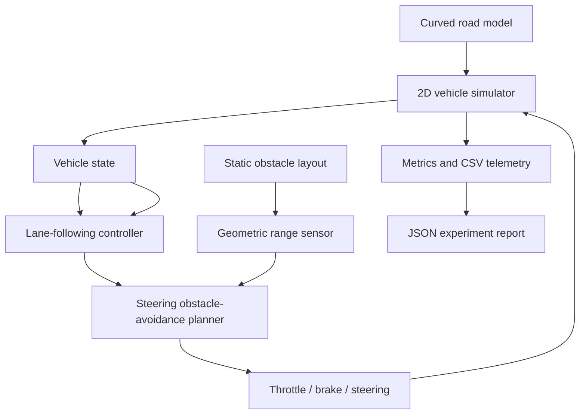

# Class Presentation Guide

## Suggested project title

**Autonomous Driving Simulation: Lane Following, Emergency Braking, and Obstacle Avoidance**

## Team

**Dalton Opudo · Dexter · William**

The team work plan assigns simulation and integration, experiment design and validation, and dashboard and presentation workstreams. Each member should document their actual implementation and evidence in [the contribution checklist](TEAM_PROJECT_PLAN.md); do not claim work that was not completed.

## One-sentence project summary

This project builds a repeatable 2D autonomous-driving simulator and compares pure-pursuit lane following, range-sensor emergency braking, and a steering-based local obstacle-avoidance planner under controlled scenarios.

## Research question

How do pure-pursuit lane following, emergency braking, and local steering-based obstacle avoidance compare in collision events and route completion?

## System architecture



The baseline controller computes lane-following steering and speed commands. The safety controller can override throttle with full braking when a relevant obstacle is too close. The steering controller chooses a collision-clear lateral offset, tracks a smooth bypass path, and returns toward lane center; if the road is too narrow to pass safely, it falls back to braking.

## Suggested 8-slide structure

1. **Motivation:** Why autonomous-driving controllers need consistent testing before more advanced models are introduced.
2. **Research question:** Compare lane following, emergency braking, and steering-based obstacle avoidance.
3. **Simulator design:** Curved road, kinematic bicycle vehicle, fixed time step, obstacles, and telemetry.
4. **Controller design:** Explain pure pursuit, range sensing, emergency braking, and smooth lateral path offsets.
5. **Experiment design:** Show the clear, center, edge, outside, and multiple-obstacle scenarios.
6. **Results:** Compare collision events and route completion for all three controllers.
7. **Limitations:** Explain the simplified static-obstacle model and lane-width assumptions.
8. **Next steps:** Moving traffic, camera perception, learning, and eventual CARLA evaluation.

## Final matched comparison report\n\nUse the dashboard's **Compare all 3 controllers** action for a matched scenario, export its JSON, and complete [the experiment report template](EXPERIMENT_REPORT_TEMPLATE.md). The report should include episode count, mean metrics, standard deviations when available, incomplete routes, and limitations. Do not use the preliminary single-run values below as final group results.\n\n## Preliminary center-obstacle result

The following values are from the first one-episode center-obstacle experiment run during development. They are a preliminary demonstration, not a statistical evaluation.

| Metric | Pure-pursuit baseline | Range-sensor safety |
| --- | ---: | ---: |
| Collision events | 1 | 0 |
| Route completion | 100% | 19.35% |
| Distance traveled | 500.16 m | 96.76 m |
| Mean lane deviation | 0.00475 m | 0.00172 m |

### Interpretation

In this run, the baseline vehicle continued through the obstacle and recorded one collision. The safety controller detected the obstacle and stopped before contact, producing zero collisions. However, it stopped at about 19.35% route completion.

The correct conclusion is that emergency braking prevented a collision in this modeled scenario, but it did not solve obstacle navigation. A more capable controller must find a safe path around the obstacle and return to the lane.

Do not describe this single run as proof of general safety or real-world performance. Repeat the experiments and report the scenario, episode count, simulator, and limitations.

## Live demonstration commands

Run these from the repository root with the virtual environment active.

```powershell
# Launch the interactive driving demo
autodrive-demo

# Run the baseline into a center obstacle
python -m autodrive_sim.benchmark --controller baseline --scenario center --episodes 1

# Run the emergency-braking controller against the same obstacle
python -m autodrive_sim.benchmark --controller safety --scenario center --episodes 1

# Run the steering-based controller against the same obstacle
python -m autodrive_sim.benchmark --controller steering --scenario center --episodes 1

# Show that an obstacle outside the path does not trigger a safety stop
python -m autodrive_sim.benchmark --controller safety --scenario outside --episodes 1

# Run the full automated test suite
python -m pytest -v
```

The current GitHub Actions pipeline validates compilation, the unittest suite, the pytest suite, and a benchmark CLI smoke test. The obstacle-scenario branch currently passes 63 pytest tests.

## Current limitations to state clearly

- This is a lightweight deterministic 2D simulator, not CARLA.
- The range sensor uses geometric ray-circle intersections; it is not a physical LiDAR sensor.
- Obstacles in the current benchmark are stationary.
- The emergency-braking controller stops rather than steering around obstacles; the local steering planner is a simplified rule-based bypass, not a general motion planner.
- No camera-based neural network has been trained yet.
- No real vehicle is controlled or tested by this project.

## Development roadmap

1. Complete deterministic obstacle scenarios and paired controller benchmarks.
2. Stress-test the local steering planner on varied obstacle placements and tighter road geometry.
3. Add moving vehicles and traffic-following scenarios.
4. Add a camera observation pipeline and labeled data collection.
5. Train and evaluate an imitation-learning model.
6. Integrate CARLA on a compatible machine or remote environment.
7. Compare controllers on matched routes and publish reproducible results.

## Presentation tip

Lead with the live center-obstacle experiment. It makes the engineering trade-off easy to understand: the baseline reaches the destination but collides; the safety layer avoids contact but stops early. Then explain how the next milestone is to achieve both collision avoidance and route completion.
